 <!-- ===================== BANNER ===================== -->

  

<!-- ===================== INTRODUCTION ===================== -->

<h1 align="center">
  
</h1>

<h3 align="center">
  CSE Undergraduate | Full-Stack Developer | React, Next.js & TypeScript | Mongo DB, Node, & Express
</h3>

  <i>Building, learning, and evolving with the ever-changing software industry.</i>

  
  
  

---

<!-- ===================== ABOUT ME ===================== -->

## 👨‍💻 About Me

- 🎓 Pursuing a **B.Sc. in Computer Science and Engineering** at Dhaka City College, Bangladesh.
- 💻 Developing full-stack web applications using **React, Next.js, and TypeScript**.
- ⚙️ Working with **Next.js App Router, API data fetching, caching, and server-side features**.
- 🔐 Implementing authentication with **Better Auth, MongoDB, OAuth, and protected routes**.
- 🎨 Building responsive interfaces with **Tailwind CSS, DaisyUI, and HeroUI, ShadcnUI**.
- 🧩 Practicing **Data Structures & Algorithms (DSA)** and competitive programming with C++.
- 🤖 Interested in building practical **AI-powered software applications**.
- 🎯 Continuously improving my engineering skills and adapting to the evolving software industry.

---

<!-- ===================== TECH STACK ===================== -->

## 🧰 Tech Stack

### 💻 Programming Languages

  

### 🎨 Frontend Development

  

  
  

### ⚙️ Backend, Database & Authentication

  

  
  

### 🛠️ Tools & Development Environment

  
  

### 🚀 Deployment

  

---

<!-- ===================== CURRENT FOCUS ===================== -->

## 🎯 Current Focus

- 🌐 **Full-Stack Development:** Building complete web applications with React and Next.js.
- ⚛️ **Frontend Engineering:** Improving component architecture, state management, and responsive UI development.
- ⚙️ **Next.js:** Working with App Router, server and client components, data fetching, and caching.
- 🔐 **Authentication:** Implementing secure authentication flows, OAuth, and protected routes with Better Auth.
- 🗄️ **Backend & Databases:** Working with REST APIs, MongoDB, and server-side application logic.
- 🧠 **Problem Solving:** Strengthening algorithmic thinking through C++ and competitive programming.
- 🤖 **AI-Powered Development:** Exploring ways to build useful applications with AI technologies.

---

<!-- ===================== FEATURED PROJECTS ===================== -->

## 🚀 Featured Projects

I build practical projects to strengthen my software engineering skills and apply what I learn.

  

  <i>Explore my pinned repositories to discover my projects, technical skills, and development journey.</i>

---

<!-- ===================== GITHUB STATISTICS ===================== -->

## 📊 GitHub Statistics

  
  

  

---

<!-- ===================== CONTRIBUTION ACTIVITY ===================== -->

## 📈 Contribution Activity

  

---

<!-- ===================== CONNECT ===================== -->

## 🤝 Connect With Me

  
  
  

  <i>Learn continuously. Build thoughtfully. Evolve with technology. 🚀</i>

